<a href="https://0xnu11ptr.github.io">
  
</a>

<p align="center">
  <a href="https://0xnu11ptr.github.io"></a>
  <a href="https://www.linkedin.com/in/mekahal-chamese-elddine-7270761bb"></a>
  <a href="mailto:mekahalchamssedin@gmail.com"></a>
  <a href="https://0xnu11ptr.github.io/blog/"></a>
</p>

<p align="center">
  
  
  
  
</p>

---

### `> whoami`

I am a **penetration tester** with **OSCP+** and **HTB CPTS**, and a background as a **full-stack developer** (C#/ASP.NET Core, React/TypeScript).

I focus on internal and external network testing, **Active Directory** compromise and **web application** assessments. Building production software every day helps me read source code like an attacker and find the **business logic flaws** that scanners miss. Every finding I report comes with a clear fix for developers and a clear risk for management.

```text
[+] Role       : Penetration Tester · Security Researcher · Full-Stack Developer
[+] Focus      : Active Directory · Internal/External Networks · Web Apps · Code Review
[+] Now        : Bug bounty hunting and writing write-ups
[+] Writing    : Notes and write-ups at 0xnu11ptr.github.io/blog
[+] Languages  : Arabic (native) · French · English
```

### 🔎 Case method

| Clue | Step | What I do |
|:---:|---|---|
| 01 | **Recon** | Ports, services, users, leaked files. Nothing is too small. |
| 02 | **Foothold** | One weak password, one bad upload, one injection is enough. |
| 03 | **Escalation** | From a low user to SYSTEM or root. |
| 04 | **Lateral movement** | Pivot through the network and follow the trust between hosts. |
| 05 | **Domain Admin** | Prove the exact path to full control. |
| ✔ | **Report** | Every step proven, every finding with a fix. *Case closed.* |

### 🗂️ Evidence on file

| Exhibit | Certification | Issuer | Date |
|:---:|---|---|:---:|
| A | **OSCP+** — OffSec Certified Professional+ | OffSec | Sep 2026 |
| B | **CPTS** — Certified Penetration Testing Specialist | Hack The Box | Jul 2026 |
| C | **CCNA** coursework (ITN, SRWE, ENSA) | Cisco Networking Academy | Jan 2025 |

### 🧰 Gadgets

**Offensive**

<p>
  
  
  
  
  
  
  
  
  
  
  
  
  
</p>

**Development**

<p>
  
  
  
  
  
  
  
</p>

### 📁 Latest case files

<!-- BLOG-POST-LIST:START -->
- [My Active Directory Enumeration Checklist](https://0xnu11ptr.github.io/blog/2026/10/ad-enumeration-checklist/)
- [From Developer to Pentester: My Road to OSCP+ and CPTS](https://0xnu11ptr.github.io/blog/2026/10/from-developer-to-pentester/)
<!-- BLOG-POST-LIST:END -->

➡️ [Read all case files](https://0xnu11ptr.github.io/blog/)

### 🕰️ Timeline

- **Jan 2025 — now** · Independent Security Researcher (Bug Bounty) — reported XSS (OpenAI) and CORS misconfiguration (Temu) through public programs
- **Nov 2024 — now** · Full-Stack Developer at **Soins et Santé Groupe** (Lyon, France · remote)
- **2020 — 2023** · B.Sc. Computer Science, Université Amar Telidji de Laghouat

---

<p align="center">
  <b>Need a penetration test or a code review with an attacker's eye?</b><br>
  <a href="mailto:mekahalchamssedin@gmail.com">mekahalchamssedin@gmail.com</a> · <a href="https://0xnu11ptr.github.io">0xnu11ptr.github.io</a>
</p>

<p align="center"><sub><b>ONE TRUTH PREVAILS.</b></sub></p>
